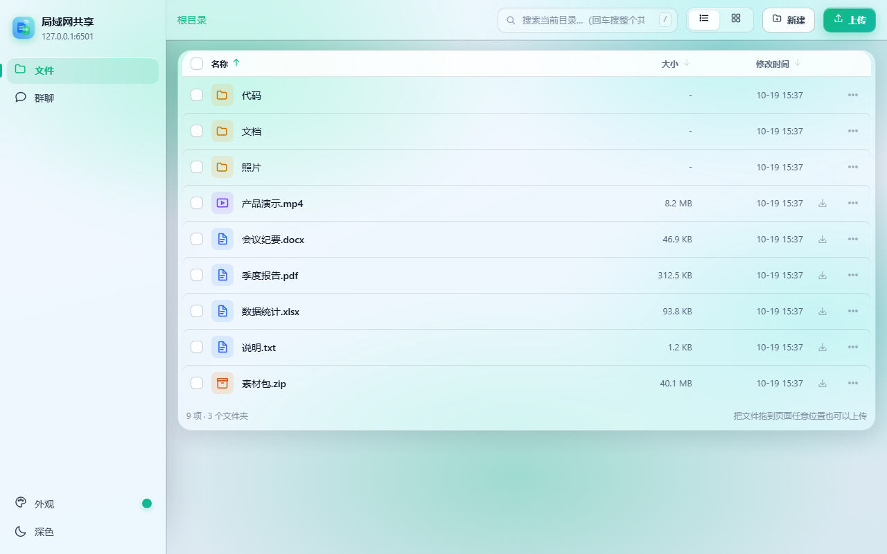
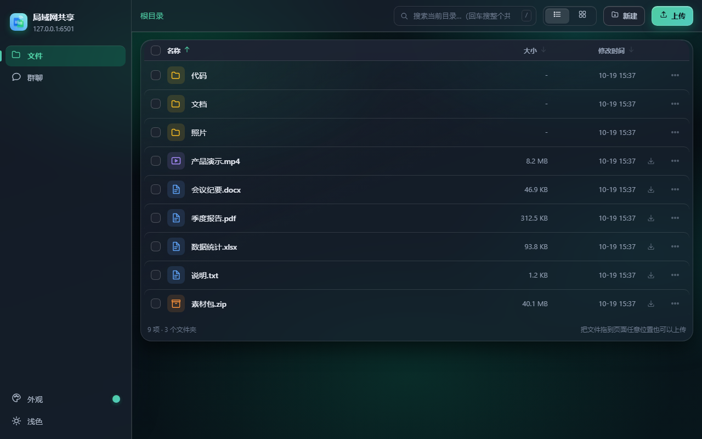
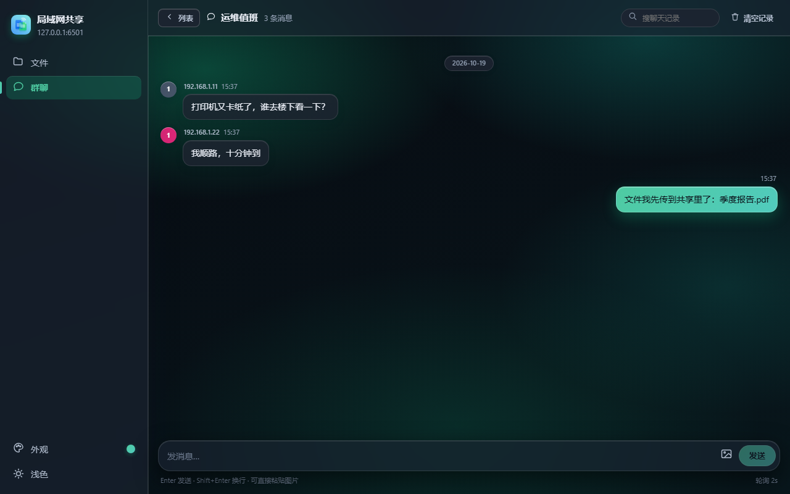
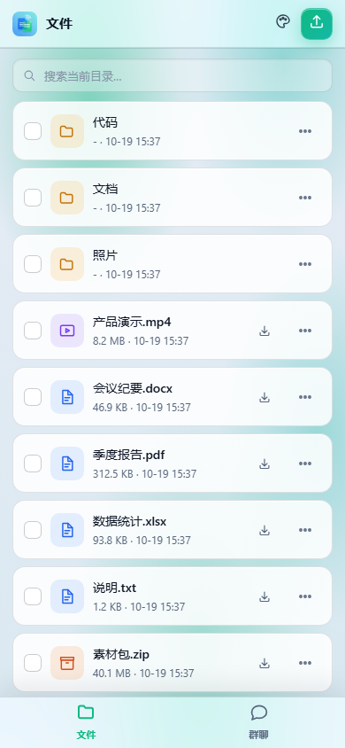
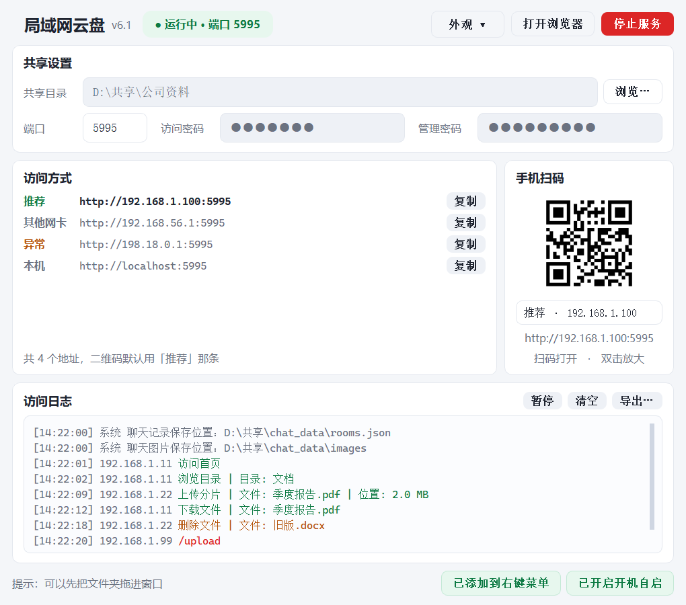
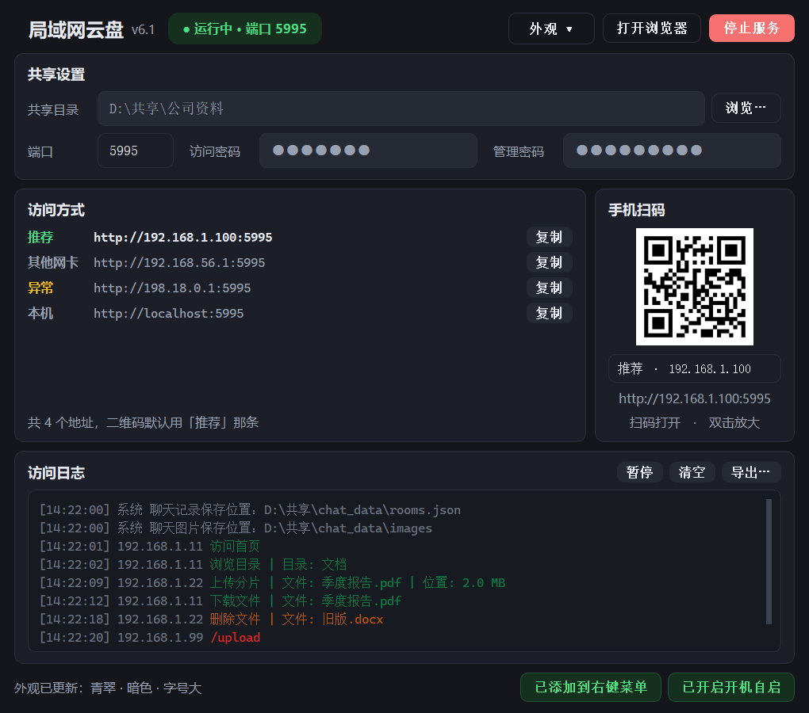

# 局域网云盘共享（LanShare）

当前源码及本地修复候选：**v7.0.1**（Windows 单文件 EXE，待故障电脑复测）。GitHub 已发布版本仍为 v7.0。

一个**不联网也能用**的局域网文件共享工具：Windows 上双击运行，同一个 Wi-Fi / 交换机下的
手机、平板、别的电脑打开浏览器就能传文件、建群聊。不经过任何第三方服务器。

- 桌面端：Python 3 + PyQt5，原生窗口 + 托盘，可打包成单个 exe
- 服务端：只用标准库 `http.server`（多线程），没有 Web 框架
- 前端：手写 HTML/CSS/JS，无构建工具、无 npm 依赖

## 能做什么

| 类别 | 能力 |
|---|---|
| 文件 | 服务端分页及全局排序 / 上传（分片 + 断点续传 + 暂停续传）/ 下载（支持 Range 续传）/ 相邻预览按钮 / 改名 / 删除 / 新建目录 / 拖拽上传 |
| 批量 | 打包下载（可续传，也可选流式）、移动 / 复制、仅当前目录 / 当前目录及子目录 / 整个共享目录搜索（根目录合并重复范围）、准确的批量操作失败提示 |
| 聊天 | 多房间及默认群改名、SSE 增删及清空同步、二进制分片图片上传、原图下载、换行及缩进保留、发送失败保留草稿 |
| 桌面 | 每用户单实例、启动 / 停止状态机、右键启动共享或切换已有实例的目录 |
| 传输层 | HTTP/1.1 长连接、gzip / br 压缩、带版本号的长缓存、并发闸门（503 保护） |
| 界面 | Web 端玻璃拟态（6 套配色 × 明暗 × 3 档玻璃，默认「翠绿」+ 浅色，深色首屏不闪白）；桌面端 6 套配色 + 明暗 + 3 档字号 |
| 安全 | 访问密码（Cookie 会话）、管理密码（写操作二次校验）、同源校验、安全响应头 |

## 界面

Web 端（浅色 / 深色，默认翠绿配色）：

<p align="center">
  
  
</p>

群聊（SSE 实时推送）与手机端：

<p align="center">
  
  
</p>

桌面端（浅色 / 深色，右上角「外观 ▾」可切 6 套配色、明暗、字号）：

<p align="center">
  
  
</p>

> 展示截图由 `python tools\screenshots.py` 使用合成数据生成，不包含真实分享或聊天内容。
> 验收记录保留实际构建和临时测试路径，便于复核；真实数据、设置和原始日志不公开。

## 快速开始

### 1. 直接用 exe（推荐）

去 [Releases](https://github.com/LFVFL/LanShare/releases/latest) 下载最新的 `lanshare.exe`，
双击运行即可，不需要安装 Python。

本次发布：[v7.0 更新说明](https://github.com/LFVFL/LanShare/releases/tag/v7.0) ·
[直接下载 EXE](https://github.com/LFVFL/LanShare/releases/download/v7.0/lanshare.exe)。

Windows 7 64 位 SP1 不能加载当前 Python 3.12 包中的 `python312.dll` 和
`api-ms-win-core-path-l1-1-0.dll`。为此额外生成了独立的 `lanshare-win7.exe`
（Python 3.8 / PyInstaller 5.13 构建，功能版本同为 7.0.1）；它不替换
Windows 10/11 使用的 `lanshare.exe`。当前是 64 位 Win7 候选，尚未在 Win7 实机确认；
32 位 Win7 不能运行此文件。构建范围、哈希和测试边界见
[Win7 x64 兼容包记录](docs/changes/2026-10-28-win7-compat-v7.0.1/README.md)。

v7.0 的窗口标题和窗口内版本号保持一致；手机聊天室的改群名按钮位于顶部，输入区不再
显示改名入口。更新、验证与交付信息见 [v7.0 发布记录](docs/changes/2026-10-28-release-v7/README.md)。

注意：v7.0 强制使用 `%LOCALAPPDATA%\LanShare\Temp` 解包，已收到其他电脑创建该路径
失败、程序无法启动的反馈。v7.0.1 本地候选撤销这项覆盖，恢复 PyInstaller / Windows 的
默认临时目录选择；正常退出后仍由 bootloader 清理本次 `_MEI*`。此修复不迁移设置或聊天
数据，不修改系统环境变量或目录权限。故障、验证范围和待确认事项见
[v7.0.1 启动修复记录](docs/changes/2026-10-28-startup-hotfix-v7.0.1/README.md)。
此前的 [临时解包记录](docs/changes/2026-10-28-startup-fix/README.md) 和
[原路径启动与界面修正](docs/changes/2026-10-28-path-and-chat/README.md) 保留为历史证据，
不代表最新候选的打包策略。

### 2. 直接运行（源码）

```bat
pip install -r requirements.txt
rem 生成 webassets.py（前端被打包进这个模块）
python tools\build_assets.py
rem 也可以指定目录和端口：python lanshare.py D:\要共享的目录 -p 5995
python lanshare.py
```

打开后点「启动服务」，窗口里会显示访问地址和二维码；手机连同一个 Wi-Fi 扫码即可。

> `webassets.py` 是构建产物（不提交进仓库），所以第一次跑必须先执行 `build_assets.py`。

### 3. 自己打包成单个 exe

```bat
python tools\build_exe.py
```

要同时打包 HEIC/HEIF、AVIF 解码器，改用：

```bat
python tools\build_exe.py --extra-images
```

脚本先重新生成前端资源，在新建的专属 ASCII 目录与虚拟环境中自检，再使用
PyInstaller 打包；检查 Qt DLL 是否完整，并以隔离设置和聊天数据启动 EXE 做冒烟验证。
产物是脚本最终打印的 `...\build-随机标识\dist\lanshare.exe`，无需旁边放 Python 或源码。
Windows 构建还核验归档中没有 `pyi-runtime-tmpdir` 覆盖，避免额外的用户目录依赖；
冒烟测试使用自有 `TMP/TEMP`、不存在的 `LOCALAPPDATA` 和全新 bootloader 环境，
并检查退出后的解包回收。这是受控环境验证，不能代替其他电脑首次双击实测。

默认使用非 Windows 系统目录内的临时位置；不足时改用其他盘，例如
`python tools\build_exe.py --work E:\LanShare-builds --extra-images`。`--work` 必须是新目录
或本工具带归属标记的构建容器，不能是源码、源码祖先或卷根；不会删除旧构建，
也不会按进程名结束已运行的网盘。虚拟环境不能位于 `C:\Windows` 内，避免
PyInstaller 的系统 DLL 过滤规则漏掉 Qt 和图片解码器依赖。

第七版取消新页面固定 5MB 的图片门槛，但保留磁盘余量、临时配额、像素和并发保护；
格式与配置见 [本轮图片说明](docs/changes/2026-10-27/chat.md)。不支持的文件格式不会
伪装成浏览器预览；HTML/SVG 等主动内容仍按附件下载，Web 接口不能在主机上启动文件。

## 目录结构

```
lanshare.py          入口：解析参数、建 Qt 应用、开主窗口
server/              HTTP 服务端（不依赖 Qt）
  config.py            常量：端口、上限、目录、安全头
  netinfo.py           网卡地址发现与排序（二维码默认指向路由器那条局域网）
  paths.py             路径清理、体积格式化
  storage.py           会话、上传锁、ZIP 临时表
  chat_store.py        聊天持久化（rooms.json 原子写 + 图片落盘）
  pages.py             模板渲染 + 图标字节
  auth.py              同源检查、Cookie 会话、管理员口令
  http_util.py         响应输出、压缩、静态资源、日志
  routes.py            页面与文件接口
  listing.py           目录项分类、面包屑、同名改名
  transfer.py          下载（Range）、上传、断点续传
  archive.py           打包下载（zip）
  fs_ops.py            本机文件操作
  chat_api.py          聊天接口（含 SSE）
  chat_media.py        图片二进制上传、解码及未发送媒体生命周期
  handler.py           路由表 + 分发
  runner.py            FastBindHTTPServer + FileSharer
ui/                  桌面界面（PyQt5）
  style.py             明暗 / 6 套配色 / 3 档字号的样式生成
  main_window.py       主窗口：状态胶囊、设置、地址清单 + 二维码、彩色日志、托盘
  qr.py                二维码渲染（segno 可选）
  icon.py / widgets.py 图标与小控件
  single_instance.py   每用户实例锁与受限本地 IPC
  context_menu.py      当前用户右键菜单
web/                 前端源码（CSS / 分片 JS / 页面模板）
  js/                  12 个分片，各自独立 IIFE，只通过 window.Lan 互相调用
  pages/               页面骨架与片段
  app.css tokens.css   组件样式与设计变量
  files-search.css     搜索范围及文件操作按钮的响应式样式
tools/               构建与测试脚本
docs/                文档（变更记录 / 架构 / 重构 / 桌面端改版）
```

## 文档

- [v7.0 发布记录](docs/changes/2026-10-28-release-v7/README.md) —— 版本号统一、手机改群名入口、源码整理及 EXE 发布
- [v7.0.1 Win7 x64 兼容包](docs/changes/2026-10-28-win7-compat-v7.0.1/README.md) —— Python 3.8 独立构建、PE 依赖扫描、最终路径启动验收及实机边界
- [第七版修改与验证记录](docs/changes/2026-10-27/README.md) —— 本轮范围、审查映射、测试、独立 EXE 和 GitHub 推送准备
- [第七版原路径启动与界面修正](docs/changes/2026-10-28-path-and-chat/README.md) —— Windows 完整性标记、搜索范围、群聊表头与输入区
- [第七版首次启动修复记录](docs/changes/2026-10-28-startup-fix/README.md) —— 临时解包路径、当时的 EXE 和隔离回归，后续以原路径修正记录为准
- [docs/ARCHITECTURE.md](docs/ARCHITECTURE.md) —— 模块划分、依赖方向、路由表、前端契约
- [docs/CHANGELOG.md](docs/CHANGELOG.md) —— 每一轮改了什么、为什么、怎么验证的
- [docs/REFACTOR.md](docs/REFACTOR.md) —— 最初的拆分方案
- [docs/DESKTOP-UI.md](docs/DESKTOP-UI.md) —— 桌面端改版（P1–P5）
- [docs/ROADMAP.md](docs/ROADMAP.md) —— 代码审查结论与优化路线（P0/P1/P2）

## 测试

全部是自带临时目录、跑完自动收拾的脚本，不需要显示器（GUI 用 offscreen）：

测试在导入应用前设置独立聊天目录，GUI 使用临时 INI 且禁用系统集成；浏览器测试启动
自己的 Chrome profile 与随机 CDP 端口。不会把现有正式服务的端口误认为测试启动成功。

```bat
rem 冒烟：页面 / 上传下载 / 聊天 / 鉴权
python tools\smoke_test.py
rem 协议层：长连接 / 压缩 / 缓存头
python tools\protocol_test.py
rem 前端行为（CDP 驱动真 Chrome）
python tools\ui_test.py
rem 管理密码全流程：上传 / 清空 / 手机端入口
python tools\admin_flow_test.py
rem 同源校验（含只发 Origin 的老浏览器）
python tools\origin_test.py
rem 桌面端界面与网卡排序（offscreen）
python tools\desktop_test.py
rem 深色模式首屏不闪白
python tools\theme_flash_test.py
rem 界面细节：图标居中 / 表头圆角 / 手机排序 / 面包屑
python tools\ui_detail_test.py
rem 打包前自检（含分片别名检查）
python tools\preflight.py
rem 重新生成上面那些界面截图（假数据）
python tools\screenshots.py
```

还有 `auth_matrix_test` / `sse_test` / `thumb_test` / `zip_test` / `search_test` /
`fsops_test` / `limits_test` / `mobile_shot`，覆盖鉴权矩阵、SSE、缩略图、打包下载、
搜索、批量操作、并发闸门和手机尺寸布局。

新增安全、聊天、桌面生命周期、分页搜索、构建保护、真实 Chrome 和独立 EXE 回归的
命令及最终结果见 [verification.md](docs/changes/2026-10-27/verification.md)。原始测试日志
默认只保存在本机并由 `.gitignore` 排除，可提交的 JSON 和合成截图见推送准备说明。

## 隐私

- 服务在本机运行，通过局域网提供访问，不主动向第三方服务器上传共享文件或聊天内容；
- 聊天记录与图片保存在程序同级目录 `chat_data/`，删掉即可清空；
- 仓库不包含真实聊天、用户设置、EXE 构建产物或原始日志；展示截图使用合成数据。
- 公开验收记录包含实际构建/临时测试路径和不含账户 SID 的权限摘要，用于核对构建与启动结果。

## 许可

MIT，见 [LICENSE](LICENSE)。

## Star History

[](https://www.star-history.com/#LFVFL/LanShare&Date)

